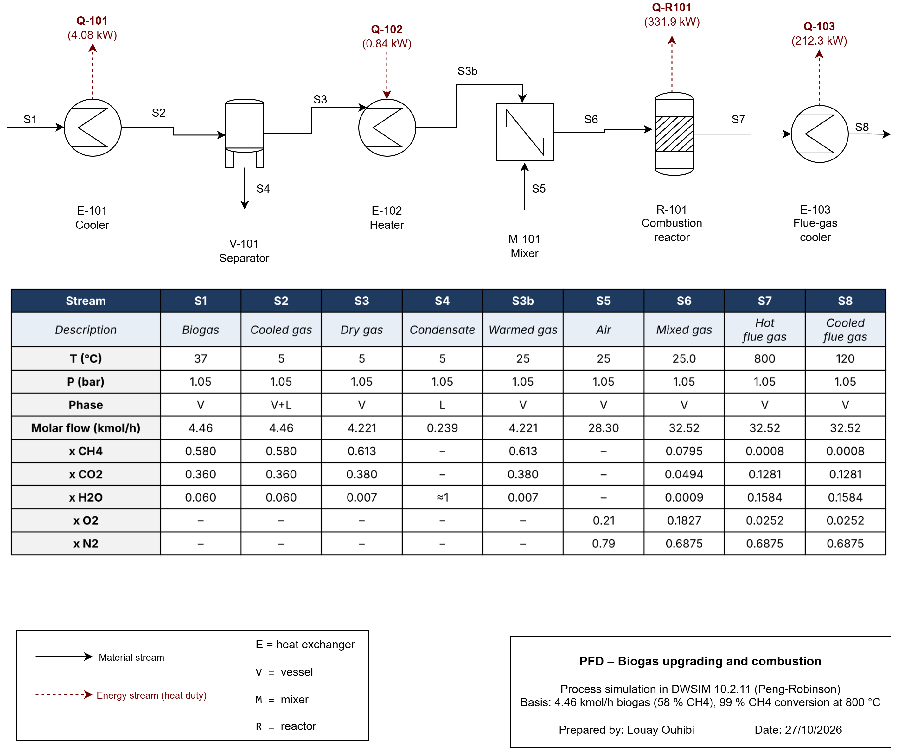

# Biogas Conditioning and Combustion – DWSIM Process Simulation

Steady-state simulation of a small biogas line in **DWSIM 10.2.11** (Peng-Robinson property package): the raw biogas is cooled and dried, reheated, mixed with air and burned. The case closes mass and energy balances, and the key results are checked against hand calculations.

**Author:** Louay Ouhibi – Industrial Biology engineer (INSAT, Tunisia)
**Tools:** DWSIM 10.2.11, draw.io, Excel
**Date:** October 2026



---

## 1. Objective

- Model biogas drying (water removal by cooling) and the associated heat duties.
- Burn the dried biogas with air in a conversion reactor and quantify the heat released.
- Recover heat from the hot flue gas and check that the energy balance closes.
- Document the flowsheet as a PFD with a stream table.

## 2. Basis and assumptions

| Item | Value |
|---|---|
| Property package | Peng-Robinson |
| Feed (S1) | 4.46 kmol/h, 37 °C, 1.05 bar |
| Feed composition (mole fraction) | CH4 0.58, CO2 0.36, H2O 0.06 |
| Operating pressure | 1.05 bar throughout (no pressure drops) |
| Air (S5) | Dry air, O2 0.21 / N2 0.79, 25 °C, 1.05 bar, 28.3 kmol/h |
| Reaction | CH4 + 2 O2 → CO2 + 2 H2O, 99 % CH4 conversion |
| Reactor outlet | Fixed at 800 °C (heat removed as Q-R101) |

## 3. Process description

| Tag | Unit | Function |
|---|---|---|
| E-101 | Cooler | Cools the biogas from 37 °C to 5 °C so the water condenses |
| V-101 | Gas–liquid separator | Splits the dry gas (S3) from the condensate (S4) |
| E-102 | Heater | Warms the dry gas from 5 °C to 25 °C |
| M-101 | Mixer | Mixes the warmed gas (S3b) with air (S5) |
| R-101 | Conversion reactor | Combustion of CH4 at 99 % conversion, outlet 800 °C |
| E-103 | Flue-gas cooler | Cools the flue gas from 800 °C to 120 °C |

Flow: S1 → E-101 → S2 → V-101 → S3 → E-102 → S3b → M-101 (+ S5 air) → S6 → R-101 → S7 → E-103 → S8. Condensate leaves V-101 as S4.

## 4. Results

### Heat duties

| Duty | Unit | Value | Direction |
|---|---|---|---|
| Q-101 | E-101 cooler | 4.08 kW | Heat removed |
| Q-102 | E-102 heater | 0.84 kW | Heat added |
| Q-R101 | R-101 reactor | 331.9 kW | Heat removed |
| Q-103 | E-103 flue-gas cooler | 212.3 kW | Heat removed |

DWSIM shows the cooler energy stream as +4.08 kW and the reactor energy stream as −331.9 kW. These are sign conventions of the energy streams. In the PFD the arrow direction carries the physical meaning and the labels show magnitudes.

### Stream table

| | S1 | S2 | S3 | S4 | S3b | S5 | S6 | S7 | S8 |
|---|---|---|---|---|---|---|---|---|---|
| T (°C) | 37 | 5 | 5 | 5 | 25 | 25 | 25.0 | 800 | 120 |
| P (bar) | 1.05 | 1.05 | 1.05 | 1.05 | 1.05 | 1.05 | 1.05 | 1.05 | 1.05 |
| Molar flow (kmol/h) | 4.46 | 4.46 | 4.221 | 0.239 | 4.221 | 28.30 | 32.52 | 32.52 | 32.52 |
| x CH4 | 0.580 | 0.580 | 0.613 | – | 0.613 | – | 0.0795 | 0.0008 | 0.0008 |
| x CO2 | 0.360 | 0.360 | 0.380 | – | 0.380 | – | 0.0494 | 0.1281 | 0.1281 |
| x H2O | 0.060 | 0.060 | 0.007 | ≈1 | 0.007 | – | 0.0009 | 0.1584 | 0.1584 |
| x O2 | – | – | – | – | – | 0.21 | 0.1827 | 0.0252 | 0.0252 |
| x N2 | – | – | – | – | – | 0.79 | 0.6875 | 0.6875 | 0.6875 |

### Sensitivity (Level 2)

The methane fraction of the biogas was varied in three cases (see `results/DWSIM_Level2_Sensitivity_Table.xlsx`). The cooling duty Q-101 stayed between 4.074 and 4.081 kW (variation below 0.2 %): it is dominated by the condensation of the water, not by the CH4/CO2 split.

## 5. Validation against hand calculations

| Check | Hand calculation | DWSIM |
|---|---|---|
| CH4 fed to the burner | 2.586 kmol/h = **576 kW** thermal input (LHV) | – |
| Heat released at 99 % conversion | **570.5 kW** | – |
| Excess air | O2 supplied 5.94 vs 5.17 kmol/h stoichiometric → **14.9 %** | O2 in S7 0.82 kmol/h ✓ |
| Total moles across the reactor | 3 mol in = 3 mol out (CH4 + 2 O2 → CO2 + 2 H2O) | 32.52 → 32.52 kmol/h ✓ |
| CO2 formed | 1.605 + 2.561 = 4.166 kmol/h | 4.166 kmol/h ✓ |
| H2O formed | 0.029 + 2 × 2.561 = 5.150 kmol/h | 5.150 kmol/h ✓ |
| CH4 left | 1 % of 2.586 kmol/h = 0.026 kmol/h | 0.0259 kmol/h ✓ |
| Energy balance | 571 kW released − ≈27 kW sensible heat of the products above 25 °C ≈ **544 kW** | Q-R101 + Q-103 = 331.9 + 212.3 = **544.2 kW** ✓ |

## 6. Repository structure

```
biogas-dwsim-simulation/
├── README.md
├── dwsim/
│   ├── Biogas_L1.dwxmz        cooler + separator
│   ├── Biogas_L2.dwxmz        + heater, sensitivity cases
│   ├── Biogas_L3.dwxmz        + mixer and combustion reactor (first Level 3 case)
│   └── Biogas_L3b.dwxmz       final flowsheet: reactor outlet 800 °C + flue-gas cooler (matches the PFD)
├── pfd/
│   ├── PFD_Biogas.drawio
│   ├── PFD_Biogas.png
│   └── PFD_Biogas.drawio.pdf
├── results/
│   ├── DWSIM_Level2_Sensitivity_Table.xlsx / .csv
│   └── DWSIM_Level3_Results.xlsx / .csv
└── screenshots/
```

The `.dwxmz` files open directly in DWSIM 10.2.11 (File > Open).

## 7. What I learned

- Building a flowsheet step by step in DWSIM: material and energy streams, unit specifications, and what "Calculated" requires (for example a conversion reactor needs both its vapor and liquid outlets connected).
- Cross-checking simulator results with hand calculations (stoichiometry, LHV, sensible heat) before trusting them.
- Reading energy-stream sign conventions and turning them into a clear PFD.

## 8. Possible extensions

- Heat recovery from the flue gas (a heat exchanger into the process or a CHP block).
- Sensitivity of flame temperature and heat duties to the air excess.
- Adding a CO2 removal step to upgrade the biogas to biomethane.
- Economic estimate of the heat recovered.
